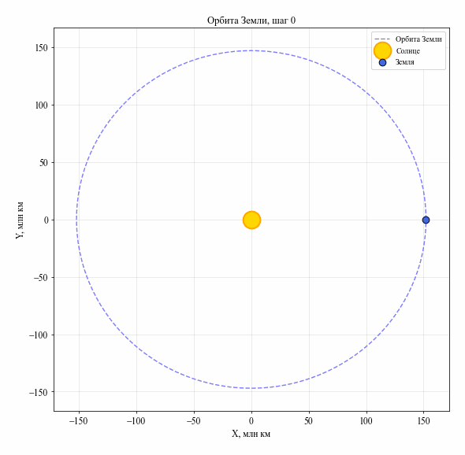
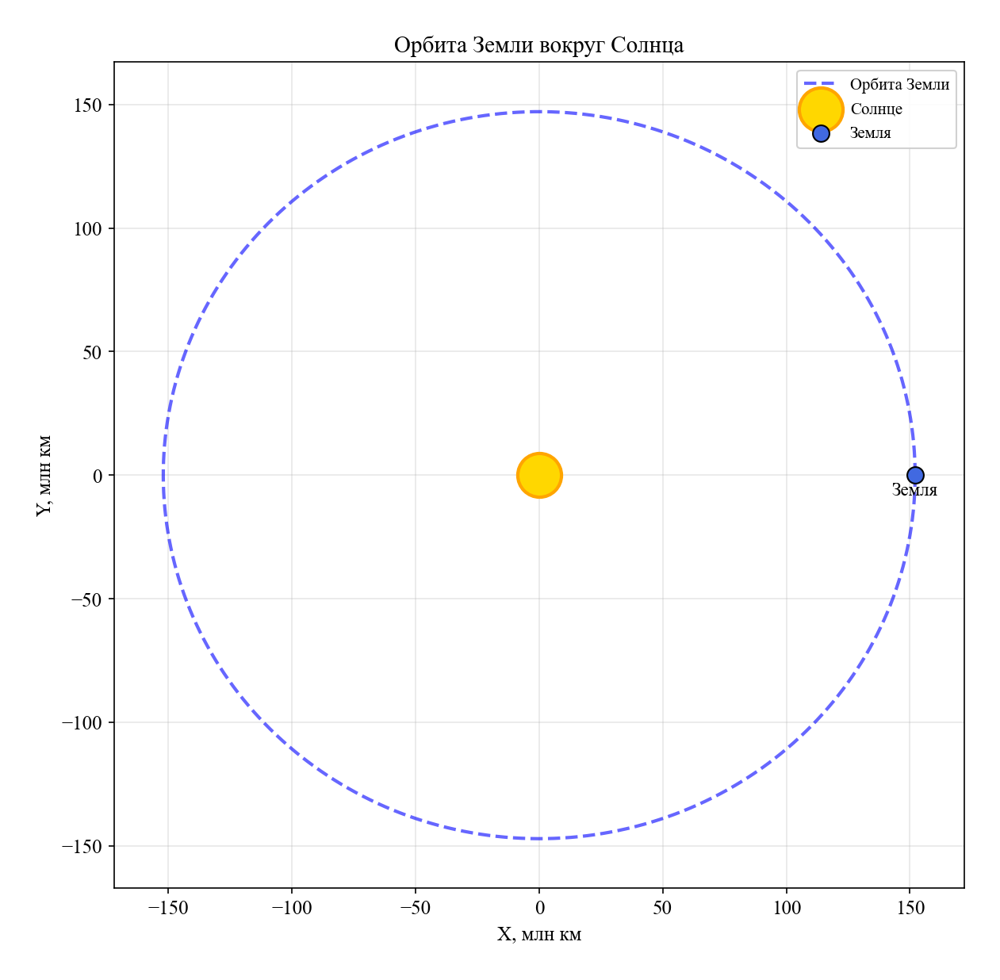
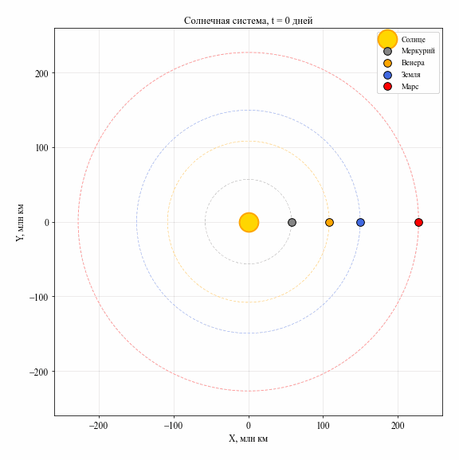
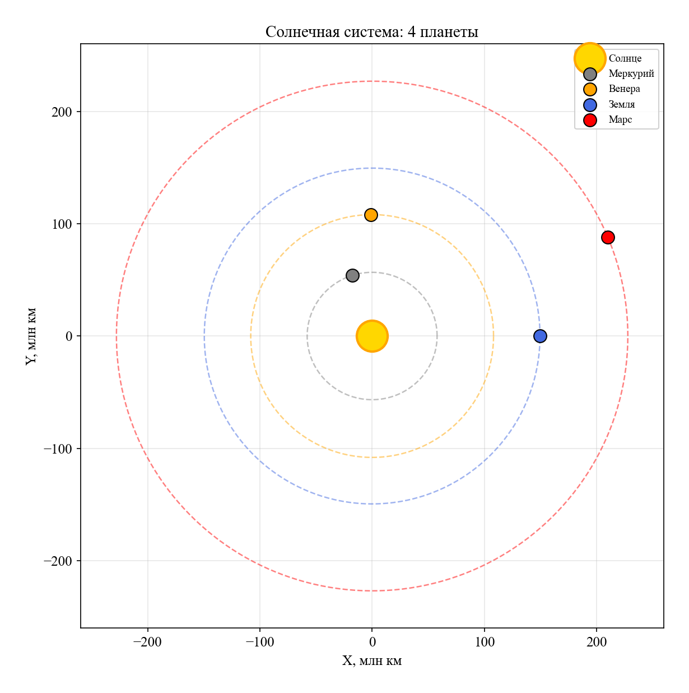
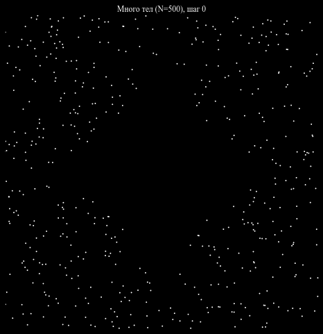
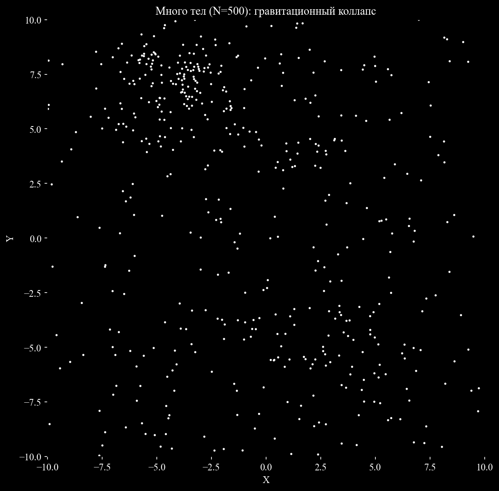
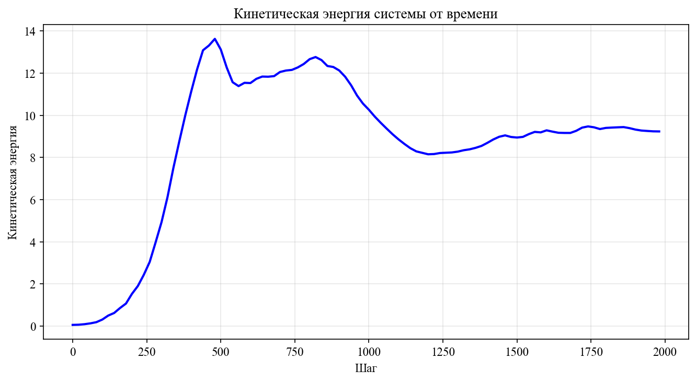
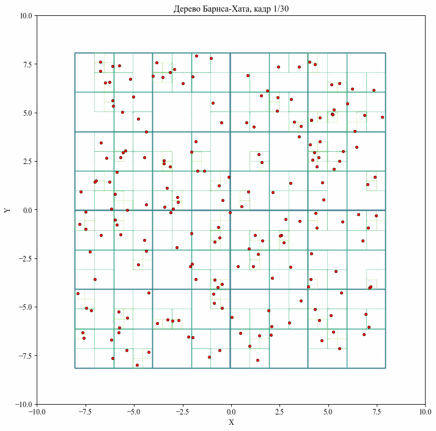
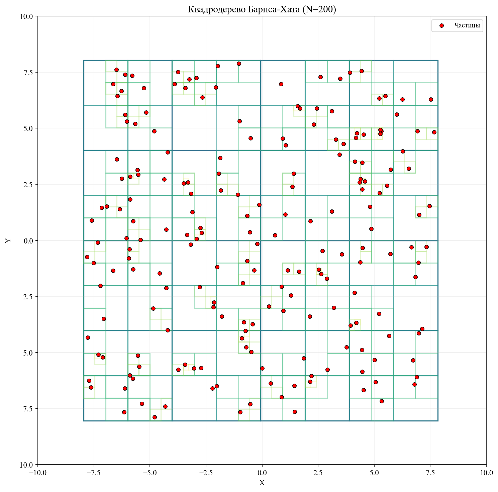
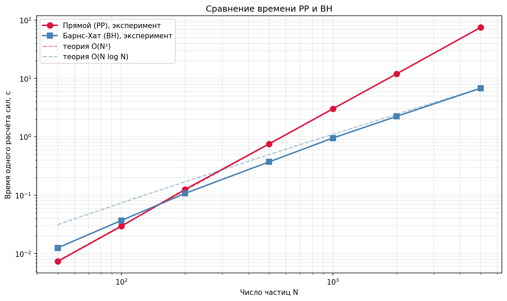

# Лабораторная работа №2: Задача N тел методом молекулярной динамики

Компьютерная модель гравитационной задачи N тел, реализованная на Python.
Включает 4 сценария — от простого к сложному.

## Сценарий 1. Задача 2 тел

Солнце в центре, Земля на эллиптической орбите.
Параметры: афелий 152,1 млн км, перигелий 147,1 млн км, период 1 год.

**Финальный кадр:**

## Сценарий 2. Солнечная система

Солнце + 4 планеты (Меркурий, Венера, Земля, Марс).

**Финальный кадр:**

## Сценарий 3. Много тел

N = 500 частиц в диске. Гравитационный коллапс.
Расчёт сил через дерево Барнса–Хата.

**Финальный кадр:**

**Кинетическая энергия:**

## Сценарий 4. Дерево Барнса–Хата

N = 200 частиц. Визуализация квадродерева — квадраты разных уровней.

**Финальный кадр:**

## Сравнение производительности PP и BH

| N | PP, с | BH, с | BH / PP |
|---|---|---|---|
| 50 | 0,0074 | 0,0108 | 1,46 |
| 100 | 0,0312 | 0,0342 | 1,10 |
| 200 | 0,1228 | 0,1207 | 0,98 |
| 500 | 0,7527 | 0,3903 | 0,52 |
| 1000 | 2,9492 | 0,9436 | 0,32 |
| 2000 | 11,7423 | 2,1449 | 0,18 |
| 5000 | 72,3582 | 6,6168 | 0,09 |

Кроссовер на N ≈ 150. При N = 5000 дерево Барнса–Хата быстрее прямого расчёта в 11 раз.

## Установка и запуск
pip install -r requirements.txt

Запуск сценариев:
python scenario_1_2body.py
python scenario_2_solar.py
python scenario_3_many.py
python scenario_4_tree.py
python time_benchmark.py

## Структура проекта
LR2/
├── md_utils.py # общие функции
├── scenario_1_2body.py # сценарий 1
├── scenario_2_solar.py # сценарий 2
├── scenario_3_many.py # сценарий 3
├── scenario_4_tree.py # сценарий 4
├── nbody_barnes_hut.py # основной код с BH
├── time_benchmark.py # замер PP vs BH
├── requirements.txt
├── README.md
└── results/ # результаты (PNG + GIF)

## Источники

1. Лекция 6 «Методы динамики частиц» (Федулов В. А., СМ6).
2. Методические указания по ЛР и ДЗ (разделы 4.2–4.6).
3. Barnes J., Hut P. A hierarchical O(N log N) force-calculation algorithm // Nature. — 1986. — Vol. 324. — P. 446–449.